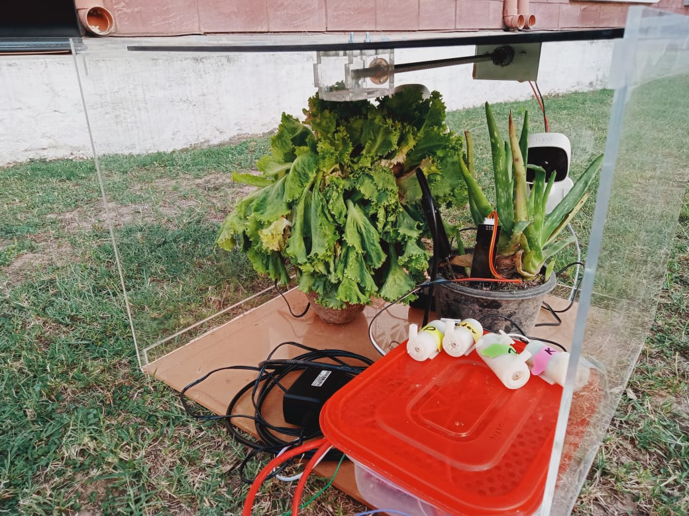
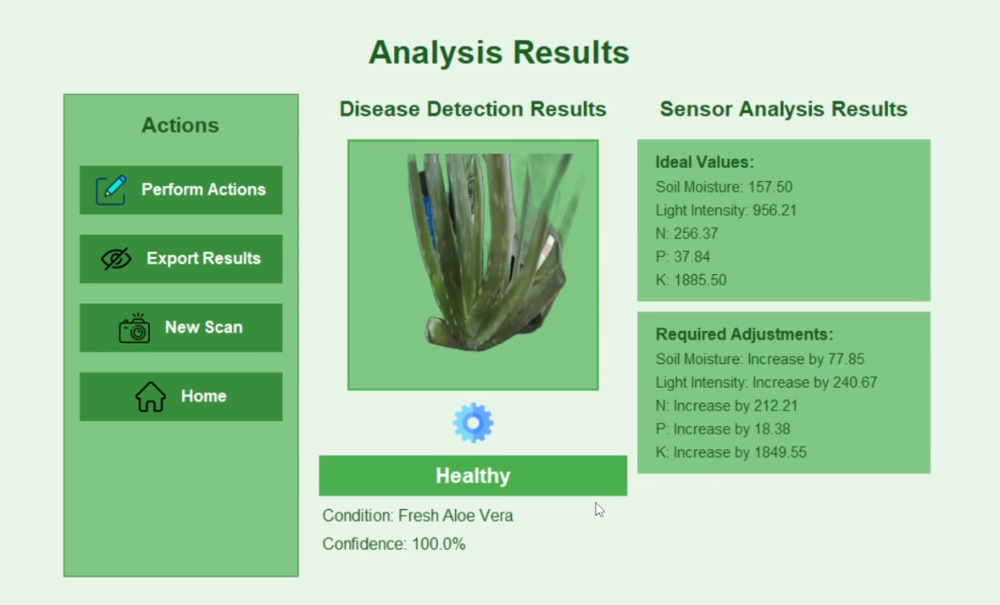
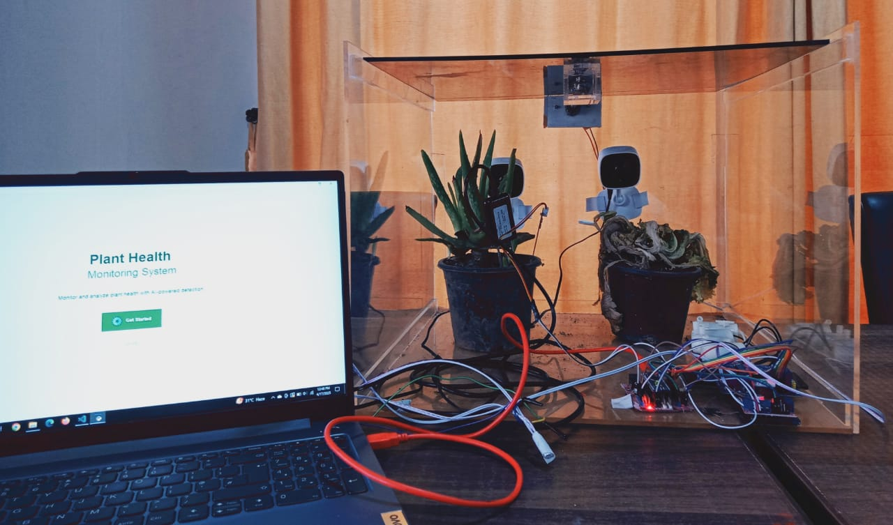

# Smart Grow 🌱

**Intelligent Solution for Sustainable and Disease-Aware Farming**

Smart Grow is an AI + IoT greenhouse system that monitors plants in real time, detects leaf diseases from camera images, predicts the plant's water / nutrient / light needs from sensor data, and automatically drives pumps and shades to correct them. It was built for **lettuce** and **aloe vera**.

Final-year project, B.E. Electrical Engineering, Military College of Signals (NUST), March 2025.



## How it works

```
 Tapo C100 camera ──► background removal ──► CNN ──────────────┐
                                                                ├──► Tkinter GUI ──► "Perform Actions"
 NPK + soil moisture + BH1750 light ──► RandomForest/XGBoost ───┘          │
                                                                           ▼ serial
                                                     ESP32/Arduino ──► water pump, N/P/K pumps, shade motor
```

1. **Disease detection (CNN).** A leaf image is captured over RTSP, its background is removed with `rembg`, and a CNN classifies it.
   - Lettuce (4 classes): Healthy, Bacterial Anthracnose, Fungal Downy Mildew, Dead
   - Aloe vera (3 classes): Fresh, Rot, Rust
2. **Environmental analysis (ML regression).** N, P, K, light and soil-moisture readings go into a regression model (Random Forest for lettuce, XGBoost for aloe vera) that predicts the ideal values and the adjustment needed for each one.
3. **Actuation.** The GUI sends the values to the microcontroller over serial, which switches relays for the water and nutrient pumps and drives an L298 motor to open or close the shade.



## Repository layout

| Path | What it is |
|---|---|
| `disease_detection/train_lettuce_cnn.py` | Train the 4-block CNN for lettuce (Adam lr 5e-4, ReduceLROnPlateau, EarlyStopping) |
| `disease_detection/train_aloevera_cnn.py` | Train the 3-block CNN for aloe vera, with classification report and confusion matrix |
| `disease_detection/test_*_cnn.py` | Classify a single image with a trained model |
| `environmental_analysis/train_lettuce_rf.py` | Random Forest regressor with grid search |
| `environmental_analysis/train_aloevera_xgb.py` | XGBoost regressor with GridSearchCV |
| `environmental_analysis/predict_from_csv.py` | Predict ideal values and adjustments for rows in a sensor CSV |
| `arduino/smart_grow_controller/` | Microcontroller sketch: sensors in, pumps and shade out |
| `gui/smart_grow_app.py` | Main Tkinter app that ties everything together |

## Hardware

- ESP32-S3-WROOM-1-N16R8 (Arduino-compatible board for the sketch)
- RS485 soil NPK sensor
- Capacitive soil moisture sensor v2.0 on GPIO 4
- BH1750 light sensor on I2C (SDA GPIO 46, SCL GPIO 18)
- 2× Tapo C100 cameras
- Relay module, water pump, N/P/K dosing pumps
- L298 motor driver with a shade motor


*Prototype greenhouse: acrylic enclosure with aloe vera and lettuce pots, two Tapo C100 cameras, the shade motor mounted on top, soil sensors, and the controller boards wired to the pumps, with the GUI running on the laptop.*

## Getting started

```bash
pip install -r requirements.txt
cp .env.example .env      # then fill in your camera URLs, serial port and base folder
```

The training scripts were written for Google Colab, so update the dataset paths at the top of each file. The GUI expects these files in `SMARTGROW_BASE_DIR`:

- `trained_lettuce_model.keras`, `aloe_vera_model.keras` (CNN models)
- `sensor_lettuce_trained model.pkl`, `sensor_aloevera_trained model.pkl` (sensor models)
- `sensor_data.csv` with columns `Soil Moisture, Light Intensity, N, P, K`
- `lettuce disease detect/lettuce dataset/test/` and the aloe vera equivalent, used to read the class names

Then run:

```bash
python gui/smart_grow_app.py
```

Upload `arduino/smart_grow_controller/smart_grow_controller.ino` with the Arduino IDE (it needs the `BH1750` library).

> Trained models and datasets are not included in this repository because of their size.

## Results (from the thesis)

| Test image | Predicted class | Confidence |
|---|---|---|
| Lettuce | Healthy Lettuce | 98% |
| Lettuce | Fungal Downy Mildew | 92% |
| Lettuce | Bacterial Anthracnose | 87% |
| Aloe vera | Fresh Aloe Vera | 100% |

On the aloe vera test set (1,500 images), 1,455 were classified correctly, about 97% accuracy.

## SDGs addressed

SDG 2 Zero Hunger · SDG 9 Industry, Innovation & Infrastructure · SDG 12 Responsible Consumption & Production · SDG 13 Climate Action · SDG 15 Life on Land

## Future work

Transfer learning and GAN-based data augmentation, on-device (edge) inference, LoRaWAN or 5G connectivity, a mobile app, and drone or satellite imaging.
